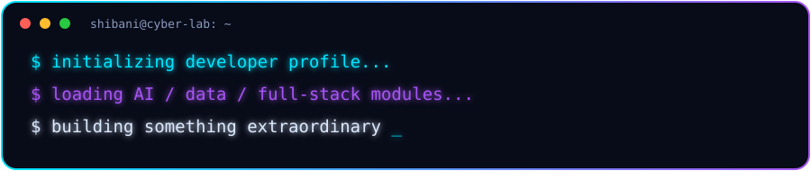

<div align="center">


<br/>


<br/>


</div>

---

## `01 / WHO I AM`



Hey, I'm **Shibani Mukherjee** — a BCA student and developer from India interested in building thoughtful digital products.

I work across **full-stack web development, Python, data analytics and applied machine learning**. I enjoy taking an idea from interface to backend, connecting APIs and databases, and turning data into useful outputs.

- 🎓 BCA student at MAKAUT
- 🧩 Building full-stack applications and data-driven projects
- 🧠 Exploring AI, machine learning and predictive analytics
- ⚡ Interested in clean interfaces, practical engineering and continuous learning
- 🌱 Currently strengthening my development and data skills

> **Build with purpose. Learn continuously. Ship thoughtfully.**

<br clear="right"/>

---

## `02 / TECH STACK`

### Development
<p>
  
</p>

### Python, Data & Machine Learning
<p>
  
  
  
  
  
  
</p>

### Tools & Workflow
<p>
  
</p>

---

## `03 / SELECTED BUILDS`

<table>
<tr>
<td width="50%" valign="top">

### ◈ AeroSense AI
**Predictive Maintenance · Python · ML · Streamlit**

A predictive-maintenance application exploring aircraft-engine degradation and Remaining Useful Life (RUL) estimation, with an interactive Streamlit experience.

`Python` `Pandas` `NumPy` `Scikit-learn` `XGBoost` `Streamlit`

[↗ View repository](https://github.com/Shibani-09/AeroSense-AI)

</td>
<td width="50%" valign="top">

### ◈ Smart Hostel Management
**MERN · Role-based application**

A full-stack hostel management system designed around student, warden and admin workflows, including authentication, gate passes, notices and complaints.

`React` `Node.js` `Express` `MongoDB` `JWT` `Tailwind CSS`

</td>
</tr>
<tr>
<td width="50%" valign="top">

### ◈ BookNest
**PHP · MySQL · Marketplace**

A competitive-exam book marketplace concept for new and pre-owned JEE, NEET, GATE and NET preparation books.

`PHP` `MySQL` `HTML` `CSS` `JavaScript`

</td>
<td width="50%" valign="top">

### ◈ Shree AI
**Virtual Human Assistant**

An AI assistant concept combining conversational AI with an interactive web experience.

`React` `Firebase` `Gemini API` `Three.js` `Framer Motion`

</td>
</tr>
<tr>
<td width="50%" valign="top">

### ◈ NeoTask AI
**React · Vite · Tailwind CSS**

A modern task-management application focused on a clean, responsive productivity experience.

`React` `Vite` `Tailwind CSS`

[↗ View repository](https://github.com/Shibani-09/neotask-ai)

</td>
<td width="50%" valign="top">

### ◈ Data & Analytics Projects
**Python · Data processing · Visualization**

Hands-on work exploring data preparation, analysis, visualization and predictive modelling through practical projects.

`Python` `Pandas` `Matplotlib` `Streamlit`

</td>
</tr>
</table>

---

## `04 / CURRENT INTERESTS`

```text
[01] Full-stack application architecture
[02] Python-based data analysis
[03] Machine learning & predictive modelling
[04] AI-powered developer tools
[05] Better UI, accessibility & user experience
```

---

## `05 / GITHUB SIGNAL`

<div align="center">


</div>

---

## `06 / CONTRIBUTION MATRIX`

<div align="center">


</div>

---

## `07 / FIND ME IN THE NETWORK`

<div align="center">

<a href="https://github.com/Shibani-09"></a>
<a href="https://www.linkedin.com/in/shibani-mukherjee-096274339/"></a>
<a href="https://instagram.com/shi_bani_188"></a>
<a href="mailto:shibanimukherjee815@gmail.com"></a>

<br/><br/>

**`ENDLESS CURIOSITY // CONSTANT ITERATION // REAL-WORLD IMPACT`**


</div>
